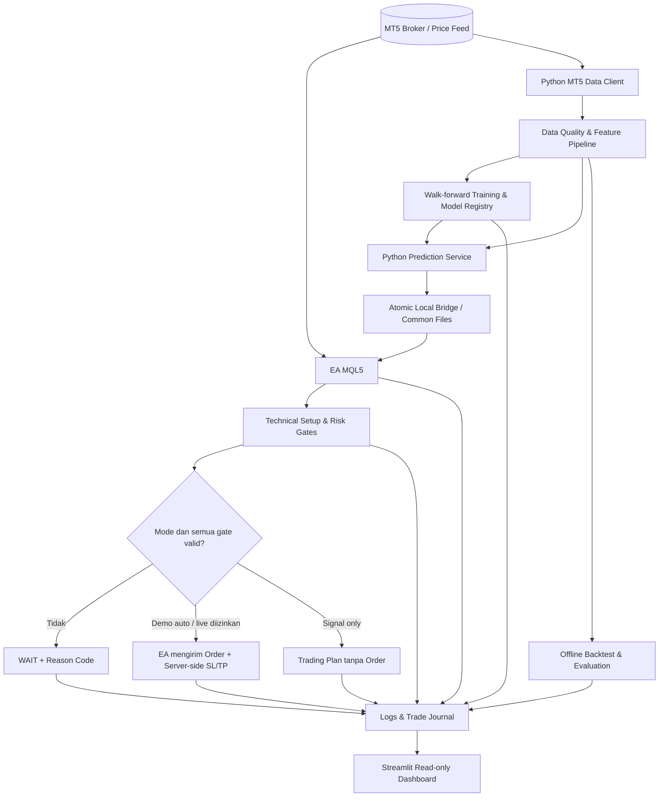
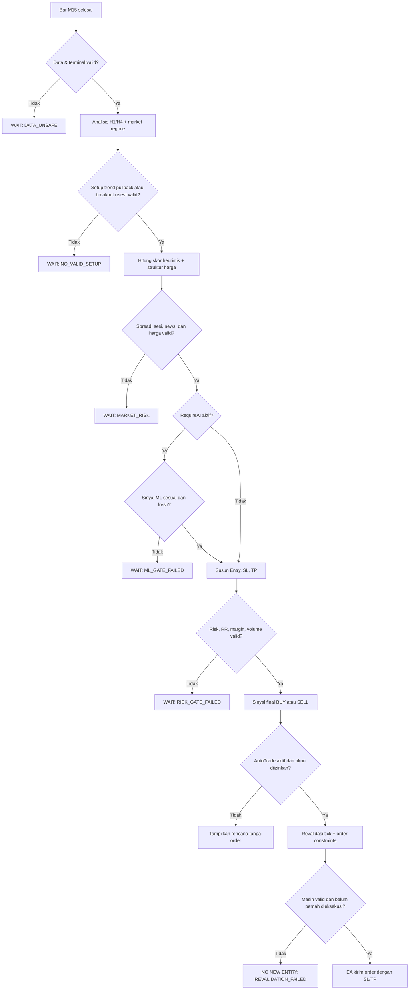
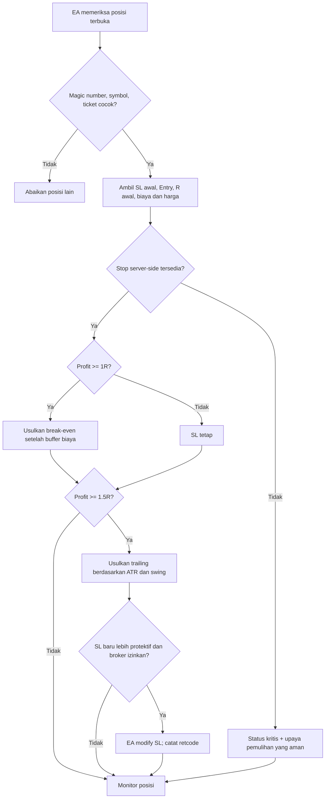
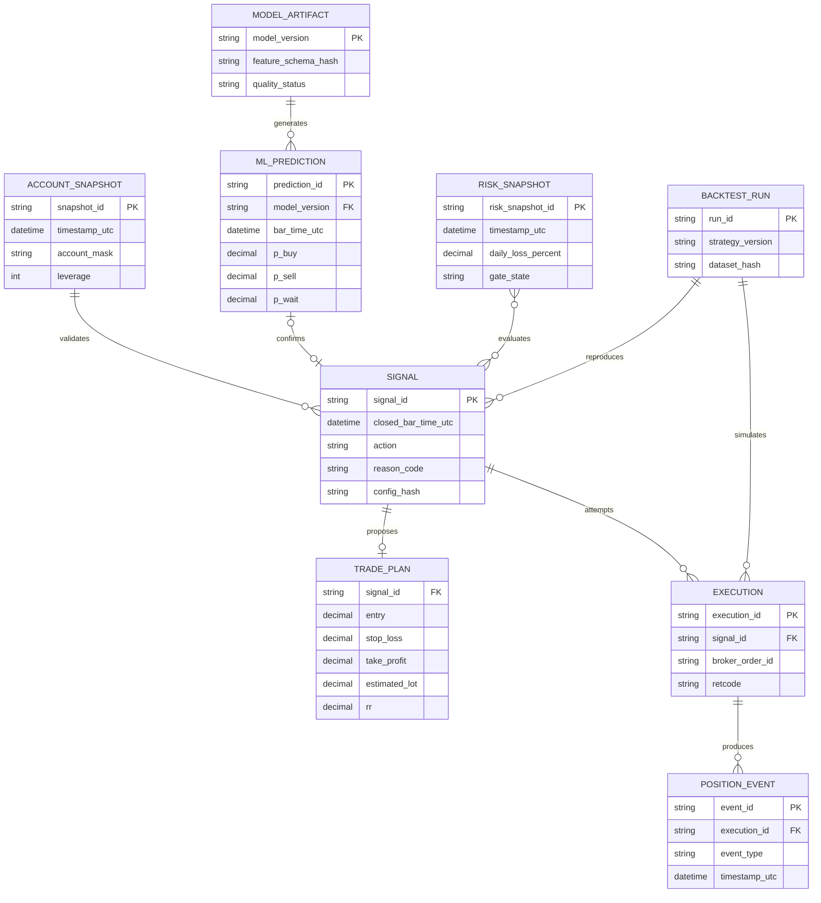

# PRODUCT REQUIREMENTS DOCUMENT (PRD)
# AURUM EXPERT AI MT5 V3.0

**Nama produk:** Aurum Expert AI MT5  
**Versi dokumen:** 1.0  
**Tanggal:** 22 November 2026  
**Platform:** MetaTrader 5 Desktop (Windows), Python lokal, Streamlit lokal  
**Instrumen utama:** Gold vs US Dollar (XAUUSD dan suffix broker)  
**Timeframe utama:** M15, konfirmasi H1/H4  
**Tipe produk:** Expert Advisor, sistem pendukung keputusan trading, dan riset strategi  
**Status:** Spesifikasi pengembangan. Belum menjadi klaim bahwa sistem, backtest, atau performa telah tervalidasi.  
**Dokumen terkait:** `PROMPT_CODEX_AURUM_EXPERT_AI_MT5_V3.md`, `BACKLOG_ISSUES_AURUM_MT5.md`, baseline Aurum v2.

---

## 1. Ringkasan produk

Aurum Expert AI MT5 adalah sistem pendukung keputusan dan Expert Advisor (EA) untuk perdagangan XAUUSD di MetaTrader 5. Sistem membantu pengguna menilai kapan lebih tepat melakukan **BUY, SELL, atau WAIT**, menyusun rencana **Entry, Stop Loss (SL), Take Profit (TP)**, dan memantau posisi terbuka.

Produk menggabungkan dua lapisan:

1. **Rule-based technical engine di MQL5**, untuk membaca kondisi pasar, menentukan setup, menghitung risiko, membuat rencana trading, dan menjadi satu-satunya komponen yang boleh mengeksekusi order.
2. **Machine learning lokal di Python**, untuk memberikan konfirmasi probabilistik yang diuji pada data historis di luar sampel. Model tidak boleh mengirim order dan tidak boleh mengesampingkan pengaman risiko.

Aurum juga menyediakan **dashboard monitoring read-only**, **trade journal**, **backtest cost-aware**, **walk-forward evaluation**, dan **audit trail**. Pengguna dapat mengoperasikan produk sebagai alat rekomendasi tanpa memasang auto-trading.

Leverage akun yang dituju adalah **1:2000**. Nilai ini ditetapkan broker, bukan EA. Produk membaca leverage aktual dan menolak order otomatis jika opsi pemeriksaan leverage diaktifkan tetapi hasilnya berbeda. Leverage yang tinggi tidak mengubah batas risiko berbasis ekuitas.

### 1.1 Pernyataan produk

> Memberikan keputusan trading XAUUSD yang konsisten, dapat dijelaskan, terukur risikonya, dan dapat diuji, tanpa menjanjikan keuntungan atau akurasi tertentu.

### 1.2 Masalah yang dihadapi pengguna

- Sulit menentukan waktu masuk berdasarkan banyak indikator dan timeframe.
- Entry dilakukan ketika harga sudah terlalu jauh dari level ideal.
- SL atau TP dipasang tanpa mempertimbangkan struktur harga, volatilitas, spread, dan aturan broker.
- Lot dihitung berdasarkan margin/leverage, bukan risiko kerugian pada harga SL.
- Terlalu sering entry, terutama setelah posisi rugi.
- Sinyal dari alat lain sering tidak menjelaskan alasan BUY, SELL, atau WAIT.
- Backtest bisa tampak bagus akibat look-ahead bias, biaya yang diabaikan, atau evaluasi model yang tidak tepat.
- Ketika terminal, AI, data, atau berita tidak tersedia, tidak jelas apakah sistem aman untuk digunakan.

### 1.3 Solusi

Aurum mengevaluasi kondisi pasar secara berurutan, menolak sinyal yang gagal memenuhi persyaratan, dan hanya membuat rencana entry jika semua syarat terkait setup dan risiko valid. Setiap keputusan menyertakan waktu candle, alasan, asumsi, dan status validitas.

---

## 2. Tujuan, indikator keberhasilan, dan batasan

### 2.1 Tujuan produk

| ID | Tujuan | Indikator penerimaan |
|---|---|---|
| OBJ-01 | Menyediakan keputusan BUY/SELL/WAIT yang dapat ditelusuri | Setiap keputusan memiliki reason code, timestamp, setup, dan hasil validasi |
| OBJ-02 | Menghasilkan Entry, SL, TP, R:R, dan lot yang sesuai aturan broker | Harga/tick/stop/volume/margin tervalidasi, invalid plan menghasilkan WAIT |
| OBJ-03 | Membatasi risiko pada akun leverage 1:2000 | Default signal-only, target risiko 0,25% ekuitas, batas harian, dan kill switch diuji |
| OBJ-04 | Menggunakan AI yang benar-benar dilatih dan dievaluasi | Artifact model, holdout metrics, walk-forward, dan quality gate tersedia |
| OBJ-05 | Menyediakan audit dan hasil riset yang dapat direproduksi | Signal log, trade log, konfigurasi, dataset metadata, dan test report tersedia |
| OBJ-06 | Memberikan transparansi kondisi sistem | Dashboard menunjukkan status koneksi, data, AI, risiko, dan hasil backtest tanpa klaim palsu |
| OBJ-07 | Memungkinkan pengembangan bertahap melalui issues | 33 seed issues memiliki file, prioritas, dependensi, acceptance criteria, dan status |

### 2.2 Metrik produk

Metrik di bawah adalah **metrik yang harus dicatat**, bukan target profit atau angka hasil yang diasumsikan.

| Area | Metrik yang dilacak | Tujuan penggunaannya |
|---|---|---|
| Sinyal | Jumlah BUY/SELL/WAIT per periode, alasan WAIT, usia sinyal | Mengukur coverage dan ketepatan operasional |
| Kualitas data | Missing bars, duplicate bars, stale signal, spread invalid | Mendapatkan gambaran kesiapan data |
| Strategi | Total trade, net P/L, profit factor, expectancy dalam R, max drawdown | Mengukur hasil setelah biaya |
| Eksekusi | Order success/rejection, retcode, spread saat entry, slippage | Mengukur eksekusi dibanding rencana |
| Risiko | Risiko rencana vs risiko aktual, margin terpakai, daily loss | Mengaudit pengaman akun |
| AI | Precision/recall per kelas, balanced accuracy, Brier score, drift, coverage | Mengukur kualitas dan relevansi model |
| Operasional | Status MT5/AI, error bridge, keterlambatan candle, recovery setelah restart | Mengukur keandalan sistem |

**Kriteria rilis tidak boleh berupa “win rate 90%” atau “profit setiap hari”.** Keputusan promosi dari riset ke demo harus didasarkan pada hasil uji yang tercatat dan ditinjau, bukan angka yang dibuat terlebih dahulu.

### 2.3 Ruang lingkup MVP

**Termasuk:**

- MT5 EA XAUUSD signal-only.
- Analisis candle tertutup M15 dan filter H1/H4.
- Dua setup utama: trend pullback dan breakout-retest.
- BUY/SELL/WAIT lengkap dengan reason code.
- Entry market yang divalidasi ulang, SL struktur + ATR, TP sesuai key level dan reward/risk.
- Lot sizing sesuai risiko, margin dan batas broker.
- Proteksi spread, sesi, berita, limit harian, posisi, dan cooldown.
- Demo auto opt-in dengan eksekusi milik EA saja.
- Break-even dan trailing stop; partial TP tetap OFF secara default.
- Python ML, model registry, bridge sinyal atomik, backtest, walk-forward.
- Dashboard lokal read-only dan trade journal.
- Dokumentasi dan backlog issue siap dipublikasikan.

**Tidak termasuk dalam MVP:**

- Broker exchange baru atau aplikasi untuk menyimpan/menarik dana.
- Trading banyak instrumen secara bersamaan sebagai fitur utama.
- Social trading, copy trading, deposit/withdrawal, KYC, dan manajemen akun broker.
- Jaminan profit, prediksi harga pasti, atau klaim AI menggantikan trader profesional.
- Eksekusi order melalui Python atau tombol BUY/SELL pada dashboard.
- LLM yang mengarang analisis atau sinyal tanpa data terverifikasi.
- Order live real-money yang otomatis aktif setelah instalasi.
- Integrasi berbayar ke penyedia berita/data tanpa persetujuan dan kredensial yang sah.

---

## 3. Target pengguna, peran, dan lingkungan

### 3.1 Pengguna utama

**Trader XAUUSD yang menggunakan MT5 desktop.** Pengguna ingin mendapatkan rencana posisi yang jelas, memahami alasan sinyal, dan membatasi risiko. Pengguna dapat membaca chart dan mengubah konfigurasi EA, tetapi tidak wajib mampu menulis kode Python atau MQL5.

**Pengembang/quant researcher.** Pengguna teknis yang menjalankan training, evaluasi, backtest, perbaikan model, dan publikasi release.

### 3.2 Hak akses dan batas eksekusi

| Komponen/aktor | Melihat sinyal | Mengubah parameter | Mengirim order | Menutup/mengubah posisi EA |
|---|---|---|---|---|
| Pengguna MT5 | Ya | Ya melalui input/preset EA | Manual melalui MT5, di luar aplikasi | Manual melalui MT5 sesuai aturan broker |
| EA MQL5 | Ya | Membaca konfigurasi yang diotorisasi | Ya, hanya mode yang diizinkan + semua gate lolos | Ya, hanya posisi yang dimilikinya |
| Python ML | Menulis konfirmasi model | Melalui CLI/config riset | Tidak | Tidak |
| Dashboard lokal | Ya | Tidak untuk fitur yang berdampak pada eksekusi | Tidak | Tidak |
| CI/automated tests | Memakai fixtures/replay | Hanya test config | Tidak boleh pada akun real | Tidak |

### 3.3 Prasyarat lingkungan

- Windows dengan MetaTrader 5 Desktop terpasang dan akun broker yang mendukung XAUUSD.
- Symbol sebenarnya dipilih dari Market Watch, misalnya `XAUUSD`, `XAUUSDm`, atau suffix lain.
- Python yang kompatibel dengan paket `MetaTrader5`, dependensi ML, dan Streamlit.
- Akses ke riwayat harga broker sesuai kebutuhan analisis; jumlah sample cukup menurut quality gate.
- Terminal harus menampilkan data valid; auto-trading memerlukan izin terminal, akun, dan simbol.
- Leverage 1:2000 **opsional secara ketersediaan broker**, namun ketika `RequireLeverage2000=true`, mismatch harus memblokir order otomatis.

---

## 4. Mode operasional

| Mode | Fungsi | Syarat | Status awal |
|---|---|---|---|
| SIGNAL_ONLY | Analisis, notifikasi, Entry/SL/TP plan, tanpa order | MT5 dan data layak baca | **Default** |
| DEMO_AUTO | Semua fungsi SIGNAL_ONLY plus order dan manajemen posisi di akun demo | `AutoTrade=true`, demo account, trading allowed, seluruh risk gate lolos | OFF |
| LIVE_ENABLED | Auto order pada akun real | Pengaturan berlapis, konfirmasi eksplisit, verifikasi akun, semua risk gate lolos | **Terblokir default** |
| RESEARCH/BACKTEST | Training, evaluasi, replay historis, simulasi biaya | Dataset terverifikasi, konfigurasi riset | Manual |
| DEGRADED | Menampilkan WAIT / status error jika AI/data/gate gagal | Dikelola otomatis | Berdasarkan kondisi |

Aturan penentuan mode:

1. `AutoTrade=false` berarti tidak boleh ada request order oleh EA, apa pun status terminal.
2. `DemoOnly=true` menolak eksekusi jika `ACCOUNT_TRADE_MODE` menunjukkan akun real.
3. Mode live memerlukan `AutoTrade=true`, `DemoOnly=false`, `LiveTradingConfirmation` eksplisit, dan izin terminal/broker.
4. `EmergencyKillSwitch=true` memblokir order baru pada semua mode.
5. Python tidak memiliki jalur ke fungsi order MT5.
6. Saat AI diwajibkan dan tidak valid, keputusan selalu WAIT. Jika AI tidak diwajibkan, sistem dapat menawarkan hasil rules-only dengan label yang jelas.

---

## 5. Arsitektur sistem

### 5.1 Diagram komponen



### 5.2 Tanggung jawab setiap layanan

| Modul | Tanggung jawab | Larangan khusus |
|---|---|---|
| EA MQL5 | Indikator, sinyal teknikal, validasi broker, risiko, order, posisi, panel chart | Tidak menyalin order posisi manual atau EA lain |
| Python data | Ambil/validasi OHLCV dan metadata broker | Tidak memakai bar terbuka sebagai bar final |
| Python ML | Feature engineering, label, training, inference, quality gate | Tidak mengeksekusi order, tidak memakai data masa depan pada fitur |
| Local bridge | Bertukar hasil AI secara atomik dan dapat diverifikasi | Tidak menerima sinyal mismatch/stale/corrupt |
| Backtest | Evaluasi cost-aware dari aturan dan ML | Tidak memakai hasil fixture sebagai bukti performa nyata |
| Dashboard | Membaca status, sinyal, audit, performa | Tidak menjadi kendali live trading |
| Scripts & CI | Setup, test, compile, publish issues | Tidak menyimpan token dan tidak mengirim order real |

### 5.3 Prinsip desain

- **Fail closed:** jika informasi penting tidak valid, blokir entry baru dan tampilkan sebab.
- **Closed-bar only:** sinyal berbasis candle yang sudah selesai.
- **Causal calculation:** tidak memakai informasi di masa depan saat fitur atau keputusan dibuat.
- **Idempotent:** satu signal ID tidak boleh menghasilkan eksekusi berulang setelah restart atau retry.
- **Broker-aware:** symbol properties, stop/freeze level, tick size, contract/tick value, volume step, filling mode, dan akun dibaca dari MT5.
- **Auditability:** keputusan dapat direproduksi dari input, versi model, konfigurasi, dan log.
- **Separation of concerns:** eksekusi tetap milik EA, ML memberikan konfirmasi, dashboard hanya monitoring.

---

## 6. User journey dan alur utama

### 6.1 Alur pertama kali digunakan

1. Pengguna menyalin file EA ke folder `MQL5/Experts`, membuka MetaEditor, lalu compile.
2. Pengguna membuka chart simbol XAUUSD broker dengan timeframe M15.
3. Pengguna mengaktifkan preset `Signal_Only.set`.
4. EA melakukan pemeriksaan koneksi, simbol, akun, spesifikasi broker, leverage, history, dan data.
5. EA menampilkan status READY atau DEGRADED dan alasan yang jelas.
6. EA menghitung sinyal setelah M15 tertutup, lalu membuat BUY/SELL/WAIT.
7. Pengguna dapat melihat Entry, SL, TP, lot estimasi, risk/reward, dan alasan.
8. Pengguna dapat menguji opsi demo-auto secara terpisah setelah verifikasi konfigurasi.

### 6.2 Activity diagram keputusan sinyal



### 6.3 Alur manajemen posisi



### 6.4 Alur training dan prediksi AI

1. `doctor` memeriksa koneksi, simbol, data, dan folder output.
2. `fetch-data` mengambil candle historis dengan metadata broker/simbol/timeframe yang jelas.
3. Data quality memeriksa timestamp UTC, gap, duplikasi, spread, dan candle tertutup.
4. Pipeline membangun fitur kausal dan label triple-barrier dengan horizon yang dinyatakan.
5. Trainer menjalankan chronological walk-forward dengan purge/embargo dan final holdout.
6. Sistem menyimpan model, feature schema, metrics, metadata, dan model version.
7. Quality gate memutuskan model `VALID` atau `DEGRADED`.
8. Runtime menghitung fitur candle tertutup terbaru dan membuat probabilitas kelas.
9. Bridge menulis hasil secara atomik ke Common Files.
10. EA memvalidasi seluruh field sinyal dan menggabungkannya dengan setup rules.

---

## 7. Functional requirements: sistem dan market data

### FR-001. Deteksi akun, simbol dan broker [AU-005]

- EA membaca `ACCOUNT_LOGIN` (ditampilkan masked di dashboard), server, trade mode, currency, equity, balance, free margin, dan leverage aktual.
- EA membaca symbol properties: `SYMBOL_DIGITS`, `SYMBOL_POINT`, `SYMBOL_TRADE_TICK_SIZE`, `SYMBOL_TRADE_TICK_VALUE` atau kalkulasi profit setara, contract size, stop/freeze level, volume min/max/step, filling mode, dan trade permission.
- Symbol dapat memiliki suffix. Program tidak menganggap semua broker memakai `XAUUSD` persis.
- Jika simbol tidak ditemukan/tidak diizinkan, hasil `NOT_READY / WAIT` dan alasan spesifik.
- Leverage mismatch hanya blokir auto-entry ketika `RequireLeverage2000=true`; diagnostik dan signal-only tetap bisa ditampilkan.

**Acceptance criteria:** simbol suffix valid dikenali; mismatch akun/izin tidak menghasilkan order; semua harga dan volume memakai properti broker.

### FR-002. Validasi candle dan tick [AU-006]

- Sinyal M15 dibuat dari candle terakhir yang sudah tertutup, bukan candle berjalan.
- Data H1/H4 menggunakan snapshot closed bars yang tersedia secara kausal pada waktu keputusan M15.
- Validasi jumlah bar minimum, timestamp monotonik, nonzero/finite OHLC, bid/ask yang masuk akal, dan gap historis.
- Identifikasi duplikasi, gap, libur pasar, anomali outlier, spread negatif/nol yang tidak valid sesuai konteks.
- Ketika data belum cukup, tampilkan `WARMUP`; saat stale, tampilkan `DATA_STALE`.

**Acceptance criteria:** test yang mengubah candle masa depan tidak mengubah fitur/keputusan lampau; sumber candle dapat dilacak lewat UTC timestamp.

### FR-003. Session dan news safety [AU-016]

- Mendukung sesi aktif yang dapat dikonfigurasi, menyesuaikan timezone broker dan perubahan daylight saving.
- Hindari rollover dan kondisi spread yang membesar.
- Gunakan kalender ekonomi MT5 untuk event USD high-impact jika tersedia.
- Parameter default news block: 30 menit sebelum sampai 15 menit sesudah event terkait, dapat diatur.
- Jika `RequireNewsFilter=true` dan kalender tidak dapat diverifikasi, tolak auto-entry dengan `NEWS_UNKNOWN`.
- Dalam Strategy Tester, gunakan fixture/replay kalender terdokumentasi, bukan mengasumsikan kalender live tersedia.

**Acceptance criteria:** berita dalam window atau status unknown yang diwajibkan menyebabkan WAIT; konversi waktu lolos skenario DST.

---

## 8. Functional requirements: analisis trader dan sinyal

### FR-004. Indikator teknikal [AU-007]

| Indikator | Default | Fungsi |
|---|---|---|
| EMA cepat/lambat M15 | EMA 20/50 | Struktur momentum entry |
| EMA arah H1 | EMA 50/200 | Filter arah utama |
| RSI | 14 | Filter momentum, bukan trigger tunggal |
| MACD | Standar 12/26/9 | Konfirmasi perubahan momentum |
| ADX, +DI, -DI | 14 | Kekuatan dan arah tren |
| ATR | 14 | Volatilitas, buffer SL, dan trailing |
| Swing high/low | Panjang lookback configurable | Struktur SL dan support/resistance |
| Support/resistance | Dari pivot/swing tertutup | Key level dan kelayakan TP |

EA harus membuat dan melepas indicator handles dengan benar, memvalidasi `CopyBuffer`, dan membaca closed-bar `shift=1` untuk sinyal final. Setiap aturan serta parameter harus ditulis di `docs/STRATEGY_RULES.md` dan dapat diuji.

### FR-005. Market regime [AU-008]

Klasifikasi:

- `TREND_UP`: arah H1/H4 naik dan struktur tren memadai.
- `TREND_DOWN`: arah H1/H4 turun dan struktur tren memadai.
- `RANGE`: tren tidak meyakinkan dan harga berada dalam area konsolidasi.
- `HIGH_VOLATILITY_UNSAFE`: lonjakan ATR/spread atau data tidak aman.

Regime digunakan sebagai filter setup. Contoh: mode MVP tidak memaksa strategi breakout ketika kondisi range tanpa konfirmasi yang sah.

### FR-006. Setup entry [AU-009]

**A. TREND_PULLBACK**

- Arah H1/H4 sesuai dengan arah transaksi.
- Harga melakukan koreksi ke zona yang ditentukan secara aturan, misalnya area EMA/struktur.
- Ada candle M15 tertutup yang mengonfirmasi continuation.
- Level invalidation dapat diidentifikasi dan jarak SL tidak melampaui batas.
- Jika harga sudah terlanjur jauh dari zona saat order akan dibuat, batalkan entry.

**B. BREAKOUT_RETEST**

- Key level ditentukan hanya dari bar historis yang tersedia.
- Breakout memenuhi syarat body/close/ATR atau aturan eksplisit yang diuji.
- Retest dan candle konfirmasi telah selesai, tidak sekadar menyentuh level intrabar.
- Entry ditolak jika breakout palsu, harga melar, atau SL/RR tidak layak.

**C. RANGE_REJECTION**

- Di luar scope awal atau opsional setelah lulus benchmark terpisah.
- Tidak boleh dicampurkan sebagai logika aktif tanpa dokumentasi dan backtest.

### FR-007. Scoring yang dapat dijelaskan [AU-010]

- Sistem menghasilkan skor heuristik `0..100` yang berasal dari komponen aturan eksplisit.
- Skor tidak dilabeli sebagai probabilitas menang.
- Semua komponen memiliki `pass/fail/weight` dan bukti indikatornya.
- Setup yang tidak memenuhi hard gate menghasilkan WAIT sekalipun skor tinggi.
- Setiap sinyal memiliki ID deterministik yang mengandung account, symbol, timeframe, closed bar, setup, dan arah.

**Contoh reason codes:** `NO_VALID_SETUP`, `HTF_CONFLICT`, `PRICE_CHASED`, `SPREAD_TOO_WIDE`, `NEWS_BLOCK`, `NEWS_UNKNOWN`, `ML_STALE`, `ML_DISAGREES`, `RISK_TOO_HIGH`, `BROKER_STOP_INVALID`, `INSUFFICIENT_MARGIN`, `LEVERAGE_MISMATCH`, `DAILY_LOSS_LIMIT`, `DUPLICATE_SIGNAL`, `DATA_STALE`, `KILL_SWITCH`.

### FR-008. Keputusan akhir [AU-010, AU-022]

- Output hanya `BUY`, `SELL`, atau `WAIT`.
- Output BUY/SELL menyertakan entry plan dan waktu kedaluwarsa.
- Output WAIT wajib menyertakan alasan prioritas tertinggi dan semua gate penting yang gagal.
- Jika AI aktif, setup teknikal tetap syarat wajib. AI tidak dapat mengubah setup invalid menjadi valid.
- Jika model tidak lolos quality gate, `RequireAI=true` menghasilkan WAIT. Jika `RequireAI=false`, sinyal rules-only harus diberi label.
- Sinyal tidak otomatis dianggap “peluang pasti berhasil”.

---

## 9. Functional requirements: Entry, SL, TP dan lot

### FR-009. Rencana Entry [AU-011]

Setiap rencana memiliki:

- Arah BUY/SELL, setup, market regime, dan level kunci.
- Jenis order: MARKET untuk MVP; pending LIMIT hanya setelah diuji terpisah.
- Rencana entry BUY berdasarkan harga Ask dan SELL berdasarkan Bid saat rencana dihitung.
- Zona entry, batas pergeseran harga yang diizinkan, masa berlaku sinyal, dan asumsi spread.
- Revalidasi harga dan persyaratan broker tepat sebelum order, termasuk new tick, margin, SL/TP, posisi, dan status gate.

### FR-010. Stop Loss dinamis [AU-011]

- SL didasarkan pada titik invalidation struktur (swing/pivot) dengan buffer ATR yang terukur.
- SL BUY harus berada di bawah harga entry yang dieksekusi; SL SELL harus di atas entry.
- Ikuti tick-size rounding serta stop/freeze level broker.
- Batas awal `MaxStopDistanceATR=3.0`. Jika jarak SL terlalu jauh, sistem tidak memaksa memperkecil SL hanya untuk masuk.
- SL server-side dikirim bersamaan dengan order jika dukungan broker memungkinkan; jika order protection gagal, jangan menyembunyikannya sebagai trade terlindungi.
- Biaya, gap, dan slippage dapat menyebabkan realized loss lebih besar daripada target per trade.

### FR-011. Take Profit dan reward/risk [AU-011]

- Default perencanaan TP mempertimbangkan target R, support/resistance terdekat, spread dan biaya.
- `MinPlannedRR=2.0` sebagai nilai awal yang dapat dikonfigurasi. Jika ruang realistis ke key level tidak mencapai nilai ini, keluaran WAIT.
- TP tunggal wajib pada MVP. TP1/TP2 opsional sebagai pengembangan dengan tes volume dan ownership.
- TP BUY berada di atas entry; TP SELL berada di bawah entry.
- Perhitungan R:R mengacu pada entry yang realistis, SL dan biaya estimasi yang terdokumentasi.

### FR-012. Position sizing [AU-012]

- Risiko target default `RiskPercentPerTrade=0.25%` dari ekuitas akun.
- Kalkulasi ukuran lot menggunakan risiko pada jarak entry ke SL yang dievaluasi oleh `OrderCalcProfit`, bukan aturan pip tetap.
- Round volume mengikuti volume step dan min/max broker serta cap `MaxLot=0.05`.
- Gunakan `OrderCalcMargin` dan batasi pemakaian free margin oleh satu entry maksimum `15%`.
- Jika lot minimum broker sudah melampaui budget risiko, hasil WAIT. Jangan membulatkan naik agar order tetap masuk.
- Periksa ulang volume, risiko, dan margin pada tick eksekusi.

**Contoh hitung risiko (ilustrasi, bukan rekomendasi trading):**

Ekuitas USD 1.000, risiko 0,25% berarti budget kerugian pada SL sekitar USD 2,50 sebelum gap/slippage/biaya. Lot ditentukan dari spesifikasi XAUUSD broker dan jarak SL. Leverage 1:2000 tidak mengubah budget USD 2,50 ini. Jika volume minimum broker menyebabkan kerugian yang diperkirakan melebihi budget, entry ditolak.

### FR-013. Risk gates [AU-012, AU-013, AU-016]

| Parameter | Default awal | Akibat gagal |
|---|---:|---|
| `AutoTrade` | `false` | Tidak kirim order |
| `DemoOnly` | `true` | Blokir akun real |
| `RequireLeverage2000` | `true` | Blokir auto entry bila leverage aktual bukan 1:2000 |
| `RiskPercentPerTrade` | `0.25` | Lot dihitung ulang atau entry ditolak |
| `MaxLot` | `0.05` | Batasi volume; tolak jika risiko/volume tidak valid |
| `MaxDailyLossPercent` | `2.0` | Blokir entry baru |
| `MaxEntriesPerDay` | `3` | Blokir entry baru |
| `MaxOpenPositionsPerSymbol` | `1` | Blokir entry baru |
| `MaxMarginUseOfFreeMarginPercent` | `15` | Blokir entry baru |
| `MaxConsecutiveLosses` | `3` | Cooldown entry baru |
| `BreakEvenAtR` | `1.0` | Kelola posisi existing saat syarat terpenuhi |
| `TrailingStartR` | `1.5` | Kelola posisi existing saat syarat terpenuhi |
| `MaxStopDistanceATR` | `3.0` | WAIT jika SL terlalu jauh |
| `RequireAI` | `false` | Jika true, AI invalid berarti WAIT |
| `RequireNewsFilter` | `true` pada auto | Jika news unknown, blokir entry baru |
| `EmergencyKillSwitch` | `false` | Jika true, blokir entry baru segera |

**Daily loss:** baseline ekuitas ditentukan pada pergantian hari broker dan disimpan persisten. Setelah restart, baseline tidak boleh di-reset sesuka hati. Pengukuran perlu memasukkan penurunan ekuitas termasuk floating loss terhadap baseline sesuai definisi risiko terdokumentasi. Ketika gate terpicu, order baru terblokir, tetapi proteksi posisi yang sudah terbuka tetap berjalan.

---

## 10. Functional requirements: eksekusi dan posisi

### FR-014. Eksekusi demo otomatis [AU-014]

- EA satu-satunya pemilik fungsi order.
- Order menggunakan CTrade, filling mode broker, deviation yang dikonfigurasi dan pemeriksaan hasil `retcode`.
- EA menyimpan `signal_id` dan status eksekusi, termasuk setelah restart.
- Sebelum entry, pastikan tidak ada posisi milik EA pada simbol melebihi batas.
- Ketika timeout atau response ambigu, periksa order/deals terminal sebelum retry.
- Retry harus terbatas dan tidak boleh menghasilkan dua order dari satu sinyal.
- Order yang diterima dilacak dengan ticket dan magic number.

### FR-015. Manajemen posisi [AU-015]

- Posisi hanya dimodifikasi jika kombinasi account, symbol, magic number, dan ticket sesuai.
- Break-even pada +1R dengan buffer yang mempertimbangkan biaya; perubahan dilakukan hanya bila broker mengizinkan.
- Trailing mulai +1,5R berdasarkan ATR/swing; SL tidak boleh dipindahkan ke arah yang memperbesar risiko.
- Status retry/modify dan retcode tercatat.
- Partial TP default OFF. Jika diaktifkan kemudian, validasi lot tersisa, volume step, mode netting/hedging, dan anti-duplikasi.
- Time-based exit dan close berdasarkan invalidation adalah fitur opsional yang membutuhkan aturan dan tes terpisah.
- Jika Python ML berhenti, EA tetap dapat mengelola posisi yang sudah ada ketika terminal/broker mengizinkan.

### FR-016. Restart dan pemulihan [AU-013, AU-014, AU-015]

- Saat EA restart, sistem memuat state persisten dan merekonsiliasinya dengan posisi/deals terminal.
- Sistem tidak boleh menganggap order gagal hanya karena file state tidak ditemukan.
- Posisi existing tidak boleh kehilangan server-side SL/TP tanpa alert kritis.
- Daily loss baseline, trade count, dan signal IDs tidak hilang akibat restart.
- Kegagalan rekonsiliasi memblokir entry baru sampai status diketahui.

---

## 11. Functional requirements: Python AI

### FR-017. Dataset dan feature engineering [AU-005, AU-006, AU-017]

Data minimum: `timestamp_utc`, `open`, `high`, `low`, `close`, `tick_volume`, `spread` (ketika tersedia), simbol, timeframe, broker/source metadata. Fitur hanya menggunakan nilai yang diketahui pada timestamp keputusan.

Fitur kandidat:

- Return historis 1/3/5/8 candle.
- EMA gap/slope, RSI, MACD histogram, ATR relatif, ADX.
- Rasio body terhadap range, panjang wick, volatilitas relatif.
- Breakout distance, swing/key-level distance.
- Spread terhadap ATR, relative tick volume.
- Encoding sesi dan alignment higher-timeframe yang sudah tertutup.

Fitur tidak boleh memakai `shift(-n)`, future close, hasil TP/SL, atau label sebagai input prediksi.

### FR-018. Label triple-barrier [AU-018]

- Horizon awal `8` candle M15 (configurable).
- Barrier profit/loss ditentukan secara eksplisit menggunakan ATR/SL/TP atau konfigurasi simetris.
- Label `BUY`, `SELL`, `WAIT` dihasilkan dari hasil masa depan hanya pada training, tidak dipakai sebagai fitur saat runtime.
- Jika dalam satu candle kedua barrier tersentuh, gunakan kebijakan konservatif seperti no-trade atau stop-first yang konsisten dengan backtest.
- Row historis yang belum mempunyai horizon penuh tidak boleh diberi label secara paksa.

### FR-019. Training dan evaluasi [AU-019]

- Baseline model: `RandomForestClassifier` dengan random seed tetap.
- Split kronologis dengan walk-forward, purge dan embargo sesuai horizon label; jangan shuffle.
- Final holdout dipisah sebelum tuning, dan threshold tidak boleh dioptimasi pada final holdout.
- Laporan menyimpan data coverage, rentang waktu, broker, simbol, jumlah bar, label balance, fold metrics, final holdout metrics, dan biaya asumsi.
- Metrik minimal: confusion matrix, precision/recall per kelas, balanced accuracy, coverage, Brier/calibration jika probabilitas diperlakukan sebagai angka probabilistik.
- Bandingkan rules-only, ML-only diagnostik, rules + ML, dan WAIT baseline.

### FR-020. Model registry dan quality gate [AU-020]

- Simpan model version, feature schema/hash, training window, source, generated/expiry time, metrics, dan configuration hash.
- Model dianggap tidak valid jika file corrupt, tidak dipercaya, schema mismatch, expired, data input tidak layak, atau quality gate gagal.
- Model yang tidak lulus tidak boleh memberikan persetujuan pada auto-entry saat `RequireAI=true`.
- Retain artifact model sebelumnya untuk rollback, tetapi jangan mengaktifkan model expired/gagal quality gate.
- File `.joblib` hanya dimuat dari lokasi tepercaya. Jangan memuat file model yang dikirim pihak tidak dikenal.

### FR-021. Runtime inference [AU-020, AU-021]

- Jalankan inferensi sekali per M15 closed bar, atau hanya ketika ada bar baru yang valid.
- Output `p_buy`, `p_sell`, `p_wait` dalam rentang `[0,1]` dengan pemeriksaan jumlah probabilitas mendekati 1.
- Output class tidak otomatis menjadi order. EA mengonfirmasi setup dan semua risk gates.
- Jika model berbeda arah dari setup, action final WAIT dengan alasan `ML_DISAGREES` atau threshold gate yang tepat.
- Probabilitas tidak boleh disebut “persentase pasti menang” tanpa evaluasi calibration yang relevan.

---

## 12. Kontrak local bridge Python ke MQL5

### FR-022. File bridge atomik [AU-021]

File ditulis di lokasi `TerminalInfo` Common Files yang benar-benar disepakati Python dan MQL5. Python menulis file sementara lalu melakukan atomic replace. EA hanya membaca file final yang lolos validasi. Schema dan metode encoding harus diuji pada parser MQL5 sebenarnya.

**Field wajib:**

| Field | Tipe | Keterangan |
|---|---|---|
| `schema_version` | string | Versi schema bridge |
| `model_version` | string | Model yang membuat prediksi |
| `account_login` | string/int | Identitas akun, tidak ditampilkan mentah di dashboard |
| `server` | string | Server broker yang sesuai |
| `symbol` | string | Simbol persis termasuk suffix |
| `timeframe` | string | `M15` pada default |
| `bar_open_time_utc` | ISO8601/epoch | Bar M15 terakhir yang sudah selesai, definisi wajib konsisten |
| `generated_at_utc` | ISO8601/epoch | Waktu dibuat |
| `expiry_utc` | ISO8601/epoch | Batas validitas |
| `action` | enum | `BUY`, `SELL`, `WAIT` |
| `p_buy` | number | Nilai 0..1 |
| `p_sell` | number | Nilai 0..1 |
| `p_wait` | number | Nilai 0..1 |
| `quality_status` | enum | `VALID`, `DEGRADED`, `ERROR` |
| `checksum` | string | Integritas payload atau mekanisme setara |

**Ketentuan penolakan:** file parsial, schema tidak dikenal, timestamp salah, file expired, akun/simbol/server salah, versi model tidak sah, angka NaN/out-of-range, atau action/probability tidak konsisten menghasilkan `ML_INVALID`/WAIT saat AI wajib.

**Contoh ilustrasi saja (bukan format parser final):**

```json
{
  "schema_version": "1.0",
  "model_version": "rf-2026-11-22-001",
  "account_login": "000000",
  "server": "DemoServer",
  "symbol": "XAUUSD",
  "timeframe": "M15",
  "bar_open_time_utc": "2026-11-22T11:45:00Z",
  "generated_at_utc": "2026-11-22T12:00:05Z",
  "expiry_utc": "2026-11-22T12:15:00Z",
  "action": "WAIT",
  "p_buy": 0.28,
  "p_sell": 0.22,
  "p_wait": 0.50,
  "quality_status": "VALID",
  "checksum": "PLACEHOLDER_FOR_DOCUMENTATION"
}
```

Nilai contoh di atas bukan harga pasar, sinyal sungguhan, atau payload siap dipakai. Implementasi harus menetapkan encoding, checksum dan field canonicalization secara lengkap dalam `docs/SIGNAL_SCHEMA.md`.

---

## 13. Dashboard dan tampilan produk

Dashboard dibuat dengan Streamlit untuk monitoring lokal. Tidak ada tombol order. Tampilan chart MT5 dapat memakai panel teks/objek MQL5 untuk menampilkan sinyal saat terminal aktif.

### Halaman 1. Overview / System Status [AU-026]

**Tujuan:** pengguna mengetahui kesiapan sistem sebelum bertindak.

**Komponen:**

- Status koneksi MT5, server masked, akun demo/real, symbol, timeframe, actual leverage.
- Mode saat ini: SIGNAL_ONLY / DEMO_AUTO / LIVE_ENABLED.
- Kesiapan AI: model version, valid/degraded, candle terakhir, usia sinyal.
- Ringkasan hard risk gates (aktif/nonaktif, alasan gagal).
- Last update dan error terakhir dengan timestamp.

**State:** jika belum ada data, tampilkan `Belum ada data dari MT5` dan langkah pemulihan. Jangan menunjukkan angka simulasi sebagai data nyata.

### Halaman 2. Live Signal / Trading Plan [AU-022, AU-026]

**Tujuan:** menilai rekomendasi trading pada candle tertutup terbaru.

**Komponen:**

- Status besar BUY, SELL atau WAIT beserta waktu keputusan.
- Setup `TREND_PULLBACK` / `BREAKOUT_RETEST`, market regime, timeframe konfirmasi.
- Zona entry, SL, TP, reward/risk, lot estimasi, uang risiko dan reward estimasi.
- Reason codes, skor heuristik, ML class/probability (jika tersedia), news status, spread.
- Semua invalidation condition dan expiry signal.
- Catatan perbedaan antara rencana harga dan harga eksekusi riil.

### Halaman 3. Market Analysis [AU-007, AU-008, AU-009, AU-026]

**Tujuan:** memperlihatkan alasan teknikal dan konteks pasar.

**Komponen:**

- Alignment H4, H1, M15.
- EMA, RSI, MACD, ADX, ATR dan data candle yang dipakai.
- Support/resistance dan swing level yang valid.
- Setup checklist (lolos/gagal) dan penjelasan singkat.
- Spread, sesi aktif dan status news risk.

### Halaman 4. Open Positions & Risk [AU-013, AU-015, AU-026]

**Tujuan:** memantau posisi EA, risiko aktif, dan batas akun.

**Komponen:**

- Daftar posisi yang dimiliki EA saja: ticket masked, side, entry, lot, SL/TP, floating P/L dan R berjalan.
- Status break-even, trailing stop, modifikasi terakhir, broker retcode.
- Daily equity baseline, daily loss, jumlah entry, jumlah loss beruntun, margin allowance.
- Status kill switch dan warning pelanggaran batas risiko.

Dashboard tidak boleh mengeksekusi modify/close order dari halaman ini.

### Halaman 5. Trade Journal [AU-027]

**Tujuan:** mengevaluasi transaksi dan penyebabnya.

**Komponen:**

- Filter tanggal, side, setup, outcome, reason code dan model version.
- Kolom waktu entry/exit, symbol, side, lot, entry, SL awal, TP awal, exit, realized P/L, R multiple, komisi, swap, spread, dan reason.
- Tautan ke signal ID, broker deal ID dan perubahan stop yang relevan.
- Export CSV untuk data yang telah dimasking jika berisi informasi sensitif.

### Halaman 6. AI Model Monitoring [AU-019, AU-020, AU-026]

**Tujuan:** melihat apakah model benar-benar siap dipakai.

**Komponen:**

- Model version, created/expiry, training period, jumlah bar/fold, feature schema.
- Accuracy metrics yang sesuai (balanced accuracy, class precision/recall, calibration jika tersedia).
- Coverage dan proporsi BUY/SELL/WAIT.
- OOS evaluation dan indikator drift/quality gate.
- Pesan jelas `ML_DEGRADED` jika model tidak valid.

### Halaman 7. Backtest & Research [AU-023, AU-024, AU-025, AU-026]

**Tujuan:** meninjau hasil evaluasi historis tanpa mencampurkannya dengan live result.

**Komponen:**

- Metadata dataset, broker, range tanggal, symbol, timeframe, cost assumptions.
- Net P/L, win rate, profit factor, expectancy R, drawdown, trades count.
- Equity curve, drawdown chart, hasil per bulan/sesi/regime.
- Rules-only vs rules + ML; sensitivitas spread/slippage.
- Status `NO VALIDATED BACKTEST` jika belum ada laporan.

### Halaman 8. Audit & Diagnostics [AU-027]

**Tujuan:** menemukan akar masalah dan melacak keputusan.

**Komponen:**

- Log structured events, bridge validity, retcode, data gap, model validity.
- Filter severity, component, signal ID, trade ID, time range.
- Perintah troubleshooting yang dapat disalin (tanpa token/password).

### Halaman 9. Active Configuration (Read-only) [AU-002, AU-026]

**Tujuan:** menampilkan parameter aktif dan menjelaskan sumbernya.

**Komponen:**

- Risk %, max lot, daily stop, leverage check, timeframe, AI required, news required.
- File preset/config version, hash atau waktu terakhir diubah.
- Keterangan bahwa perubahan parameter dilakukan melalui file config/input EA, bukan dashboard.

### 13.1 Wireframe konseptual layar sinyal

```text
+--------------------------------------------------------------------------+
| AURUM EXPERT AI | MT5: CONNECTED | DEMO | XAUUSDm | M15 | Leverage 1:2000 |
+--------------------------------------------------------------------------+
| SIGNAL: WAIT                         | Updated: [UTC time] | Expires: [...] |
| Market regime: TREND_UP              | Setup: TREND_PULLBACK              |
| Reason: PRICE_CHASED                 | Status AI: VALID                  |
+--------------------------------------------------------------------------+
| Entry plan    | Stop Loss     | Take Profit   | R:R       | Lot estimate  |
| --            | --            | --            | --        | --            |
+--------------------------------------------------------------------------+
| Timeframe       H4: UP | H1: UP | M15: CONFIRMATION NOT VALID            |
| Indicators      EMA: PASS | RSI: PASS | MACD: PASS | ADX: PASS          |
| Risk gates      Spread: PASS | News: PASS | Risk: PASS | Entry: FAIL  |
+--------------------------------------------------------------------------+
| Keterangan: belum ada entry valid. Tidak ada order yang dikirim.         |
+--------------------------------------------------------------------------+
```

Semua angka pada dashboard wajib bersumber dari broker atau hasil pengujian yang diberi label. Empty state tidak boleh memalsukan data live.

---

## 14. Data model, schema dan audit trail

### 14.1 Entitas utama

| Entitas | Field minimum | Keterangan |
|---|---|---|
| `AccountSnapshot` | `snapshot_id`, `timestamp`, `account_mask`, `server`, `trade_mode`, `leverage`, `equity`, `free_margin` | Diagnostik akun tanpa menyimpan kredensial |
| `MarketBar` | `source`, `broker`, `symbol`, `timeframe`, `bar_time_utc`, `OHLC`, `tick_volume`, `spread`, `quality_status` | Data historis/closed bar |
| `Signal` | `signal_id`, `decision_time`, `bar_time`, `side`, `setup`, `regime`, `score`, `reasons`, `valid_until`, `config_hash` | Keputusan final |
| `TradePlan` | `signal_id`, `entry_type`, `entry_zone`, `SL`, `TP`, `RR`, `lot`, `risk_money`, `margin_estimate`, `constraints` | Plan sebelum order |
| `ModelArtifact` | `model_version`, `feature_schema`, `dataset_hash`, `train_window`, `metrics_path`, `quality_status`, `expiry` | Model registry |
| `MLPrediction` | `prediction_id`, `signal_bar_time`, `model_version`, `p_buy/p_sell/p_wait`, `quality_status`, `checksum` | Output AI yang divalidasi |
| `Execution` | `execution_id`, `signal_id`, `order_id`, `deal_id`, `ticket`, `result`, `retcode`, `fill_price`, `lot` | Hasil percobaan order |
| `PositionEvent` | `event_id`, `ticket`, `timestamp`, `event_type`, `SL_before`, `SL_after`, `reason`, `retcode` | Breakeven, trailing, close |
| `RiskSnapshot` | `timestamp`, `daily_baseline`, `daily_loss`, `entries_today`, `loss_streak`, `margin_use`, `gate_states` | Pengaman pada titik waktu |
| `BacktestRun` | `run_id`, `dataset_id`, `strategy_version`, `model_version`, `cost_config`, `metrics_path`, `trade_log_path` | Hasil riset |

Data boleh disimpan sebagai JSONL/CSV/Parquet dan metadata JSON untuk MVP. Tidak wajib memakai database server. Semua event yang perlu direkonsiliasi harus menyertakan stable ID dan timestamp UTC.

### 14.2 ERD konseptual



ERD merupakan kontrak data logis. Relasi timestamp/replay dapat berbeda pada storage file, tetapi harus tersedia secara audit. Jangan menyimpulkan bahwa model memakai PostgreSQL atau layanan cloud.

### 14.3 Format log wajib

Setiap record yang relevan memiliki `timestamp_utc`, `level`, `component`, `event_type`, `signal_id` atau `ticket` saat tersedia, `reason_code`, `config_version`, `model_version`, dan hasil. Log tidak boleh memuat password broker, private API token, atau nomor login mentah pada tampilan umum.

---

## 15. Backtest, penelitian, dan validasi

### FR-023. Python cost-aware backtest [AU-023]

- Data historis harus menyertakan sumber, broker, simbol, timezone, rentang, dan data-quality report.
- Order simulation menggunakan harga yang tersedia sesuai waktu sinyal; tidak mengisi entry pada candle sebelum sinyal terbit.
- Memodelkan spread, slippage, komisi, swap ketika tersedia dan dinyatakan sebagai asumsi jika tidak tersedia.
- Mengecek stop level, volume, margin, market hours, biaya, dan urutan intrabar secara konservatif.
- Jika satu bar menyentuh SL dan TP tetapi urutan tidak diketahui, gunakan kebijakan konservatif yang konsisten dan laporkan.
- Simpan per-trade log dan jalur ekuitas.

### FR-024. MQL5 Strategy Tester replay [AU-024]

- Ekspor prediksi ML yang **out-of-sample** dengan timestamp dan model version.
- EA dapat mengakses file replay lokal yang cocok tester; tidak perlu Python live.
- File replay tidak boleh memasukkan informasi dari masa depan relatif ke candle sinyal.
- Catat perbedaan logika jika Python backtest dan MT5 tester memiliki perbedaan eksekusi.

### FR-025. Robustness analysis [AU-025]

- Uji variasi spread, slippage, parameter setup, sesi, regime, dan periode pasar.
- Bandingkan rules-only vs rules+ML dan jelaskan apakah AI memperbaiki hasil OOS.
- Bootstrap/Monte Carlo atas distribusi trade returns tersedia sebagai analisis tambahan, tidak menjamin distribusi risiko masa depan.
- Laporkan hasil buruk, tidak hanya konfigurasi terbaik.

### FR-026. Paper/demo forward testing [AU-030]

- Jalankan di akun demo dengan sumber harga broker yang sebenarnya.
- Gunakan periode pengamatan yang terdokumentasi dan mencakup perbedaan sesi/volatilitas jika memungkinkan.
- Catat order rejects, slippage, deviations, kemampuan restart recovery, trailing behavior, dan pelanggaran gate.
- Jangan mengaktifkan live trading sebagai bagian dari tes otomatis.

### 15.1 Kriteria evaluasi yang harus dipisah

1. **Kualitas model klasifikasi**: mengukur kecocokan label, bukan profit.
2. **Hasil strategi backtest**: mengukur simulasi setelah biaya, bukan hasil akun nyata.
3. **Forward demo**: mengukur perilaku pada harga broker secara berjalan, belum membuktikan keandalan masa depan.
4. **Uji integrasi broker**: mengukur kesesuaian eksekusi, stop, dan posisi.

---

## 16. Non-functional requirements

| ID | Kategori | Requirement |
|---|---|---|
| NFR-01 | Keamanan | Tidak menyimpan password broker/API token di repo atau log |
| NFR-02 | Safety | Default tanpa auto-trading; broker real terblokir kecuali opt-in berlapis |
| NFR-03 | Data integrity | Bridge ditulis atomik, tervalidasi checksum/length/schema/TTL, dan diverifikasi EA |
| NFR-04 | Data freshness | Prediksi hanya boleh untuk bar tertutup yang relevan, sebelum expiry dan sebelum new-bar mismatch |
| NFR-05 | Reliability | Gagal data/AI/koneksi memblokir entry baru; posisi existing dikelola jika memungkinkan |
| NFR-06 | Repeatability | Train/evaluate/backtest menyimpan seed, dataset hash, config, versi strategi/model dan periodisasi |
| NFR-07 | Portability | Runtime utama Windows + MT5; tes Python tanpa akun broker bisa berjalan pada lingkungan CI |
| NFR-08 | Observability | Semua keputusan/penolakan/modify/order memiliki status, reason, timestamp dan ID korelasi |
| NFR-09 | Usability | Teks dashboard dan dokumentasi utama berbahasa Indonesia yang singkat dan tidak ambigu |
| NFR-10 | Isolation | Dashboard read-only, Python tidak mengirim order, EA tidak menyentuh posisi nonmiliknya |
| NFR-11 | Recoverability | Restart tidak menggandakan order, reset day baseline atau melonggarkan stop |
| NFR-12 | Quality | Python lint, type checks, pytest; MQL5 compile/log verifikasi faktual |
| NFR-13 | Privacy | Account identifier ditampilkan masked; data trading disimpan lokal secara default |
| NFR-14 | Explainability | Setiap sinyal memiliki reason codes, rule values, model version saat AI digunakan |
| NFR-15 | Performance | Satu evaluasi per candle M15 tertutup; proses inference tidak boleh menghambat jalur proteksi posisi |

---

## 17. Prioritas keputusan dan aturan saat gagal

### 17.1 Urutan gate sebelum entry

1. Emergency kill switch dan mode/account permissions.
2. Koneksi, symbol state, tick/closed-bar validity, account consistency.
3. Spread, session, news dan market safety.
4. Setup teknikal, HTF confirmation, valid entry zone dan signal freshness.
5. AI quality/freshness/agreement jika diwajibkan.
6. SL/TP legality, reward/risk, lot risk, margin, daily limits dan posisi existing.
7. Revalidasi seluruh hal relevan pada tick eksekusi.
8. Order execution with SL/TP, retcode verification, dan audit trail.

Jika banyak gate gagal, tampilkan primary reason dan daftar secondary reasons. Tidak boleh membuka order baru demi mempertahankan frekuensi trading.

### 17.2 Matriks fallback

| Kondisi | Keputusan entry baru | Pengelolaan posisi existing |
|---|---|---|
| Python berhenti, `RequireAI=true` | WAIT | Tetap oleh EA jika terminal dan broker tersedia |
| Python berhenti, `RequireAI=false` | Rules-only sesuai gate, diberi label | Tetap |
| File bridge corrupt/stale | WAIT saat AI required | Tetap |
| News unavailable + filter required | WAIT | Tetap |
| Spread melebar | WAIT | Stop server-side tetap, trailing mengikuti aturan broker |
| Leverage bukan 1:2000 + require ON | Tidak ada auto-entry | Tetap |
| Daily loss limit tercapai | Tidak ada entry baru | Tetap, jangan melonggarkan SL |
| Emergency kill ON | Tidak ada entry baru | Stop server-side tetap, sesuai desain pengaman |
| Terminal disconnected | Tidak ada order baru | Broker server-side SL/TP tetap bergantung pada kondisi server broker |
| Restart dan state ambigu | Tidak ada order baru hingga rekonsiliasi | Rekonsiliasi posisi/ticket |

---

## 18. User stories dan acceptance criteria

| ID | User story | Acceptance criteria |
|---|---|---|
| US-01 | Sebagai pengguna, saya ingin tahu status akun dan simbol sebelum membaca sinyal. | Suffix, leverage, account mode, status connection tampil benar atau NOT_READY. |
| US-02 | Saya ingin tahu kapan harus WAIT, tidak selalu BUY/SELL. | Setiap candle eligible menghasilkan keputusan beserta reason. |
| US-03 | Saya ingin melihat alasan BUY atau SELL. | Regime, setup, indicator checks, source candle dan reason tercatat. |
| US-04 | Saya ingin melihat entry yang masih layak dieksekusi. | Entry memiliki expiry dan chase limit; pergeseran berlebihan menghasilkan WAIT. |
| US-05 | Saya ingin SL berdasarkan invalidasi harga. | SL ditentukan dari struktur dan ATR, di sisi entry yang benar, lolos stop level. |
| US-06 | Saya ingin TP rasional terhadap key level dan risiko. | TP mempertimbangkan structure/RR; jika tidak cukup, WAIT. |
| US-07 | Saya ingin lot sesuai risiko, walau leverage 1:2000. | OrderCalcProfit/Margin digunakan; lot minimum di atas risiko ditolak. |
| US-08 | Saya ingin membatasi jumlah kerugian harian. | Gate harian persisten setelah restart, memblokir entry baru jika terpenuhi. |
| US-09 | Saya ingin mencoba sinyal tanpa order otomatis. | `AutoTrade=false` tidak memanggil send order. |
| US-10 | Saya ingin auto-trading hanya pada akun demo terlebih dahulu. | `DemoOnly=true` dan real account menyebabkan block, diverifikasi tes. |
| US-11 | Saya ingin SL dan TP ada di server broker pada trade otomatis. | Order dilengkapi SL/TP; kegagalan dicatat dan safety path dipakai. |
| US-12 | Saya ingin posisi profit dikelola tanpa SL mundur. | BE dan trailing hanya memperketat SL dan menangani stop/freeze level. |
| US-13 | Saya ingin restart tidak membuka order ganda. | Signal ID, deal reconciliation dan risk counters tetap konsisten. |
| US-14 | Saya ingin AI hanya dipakai jika model valid. | Quality/freshness/schema gate; model gagal menghasilkan WAIT ketika required. |
| US-15 | Saya ingin menguji apakah AI meningkatkan strategi. | Ada walk-forward OOS, rules-only comparison dan cost-aware P/L. |
| US-16 | Saya ingin melihat ringkasan dan riwayat keputusan. | Dashboard menampilkan data terverifikasi, log dan journal read-only. |
| US-17 | Saya ingin tahu bila data/terminal bermasalah. | Status DEGRADED, reason dan troubleshooting muncul tanpa angka palsu. |
| US-18 | Sebagai developer, saya ingin issue yang bisa dikerjakan bertahap. | 33 issue seed ada sebagai file siap publish, dependensi dan test jelas. |
| US-19 | Sebagai QA, saya ingin tahu tes apa yang benar-benar lulus. | TEST_REPORT berisi PASS/FAIL/NOT RUN dan bukti. |
| US-20 | Sebagai maintainer, saya ingin bisa rollback model/versi. | Metadata artifacts dan changelog terjaga; versi invalid tidak diaktifkan. |

---

## 19. Test plan, contoh skenario negatif, dan rilis

### 19.1 Unit tests Python

- Data invalid: missing/duplicate/unsorted timestamps, OHLC tidak logis, spread stale.
- Causal features: modifikasi masa depan tidak mengubah fitur bar masa lalu.
- Triple-barrier label: horizon tidak cukup, bar ambigu, gap harga.
- Walk-forward split: training dan testing tidak overlap lewat label horizon.
- Model registry: model expired, missing feature, corrupt metadata, source mismatch.
- Bridge: atomic write, checksum mismatch, timestamp/account/symbol mismatch.
- Risk: fixed inputs menghasilkan lot yang sesuai dan penolakan saat min lot terlalu besar.
- Backtest: SL/TP ambiguous bar dinilai konservatif, biaya dan slippage tidak hilang.

### 19.2 MQL5 / terminal tests

- MetaEditor compile tanpa error pada target Windows bila tersedia.
- Sinyal memakai candle tertutup dan tidak berubah akibat candle berjalan.
- Stop level, freeze level, volume step dan filling mode berbeda.
- Leverage mismatch, real account, disable trading, max daily loss, daily reset, account restart.
- Timeout order, delayed response, partial fill, duplicate signal, rekonsiliasi deal.
- Break-even/trailing sell dan buy, SL tidak mundur.
- Ownership filter pada akun dengan posisi manual dan EA lain.
- Model/bridge offline dan live AI required.

### 19.3 Integration end-to-end

- Broker MT5 -> data Python -> training artifact -> inference -> bridge -> EA signal -> dashboard.
- Signal-only tidak mengirim order.
- Demo-auto hanya order setelah gates valid dan akun demo.
- Pengelolaan posisi tetap bekerja ketika Python offline.
- Backtest Python dan replay MT5 dibandingkan untuk identifikasi perbedaan.

### 19.4 Status wajib di laporan

Setiap tes dicatat sebagai `PASS`, `FAIL`, atau `NOT RUN` dengan alasan, lingkungan, tanggal, perintah, log, dan evidence path. Jika tidak ada MT5/MetaEditor, status compile bukan PASS.

### 19.5 Release gates

**Gate R1: Fondasi**

- Struktur repo, config, source, CI, dan issue files tersedia.
- Python unit tests dapat berjalan tanpa login broker.

**Gate R2: Signal Only**

- Chart EA mengeluarkan BUY/SELL/WAIT dengan alasan dan rencana yang valid.
- Tidak ada order dikirim pada default.
- Signal/stop/lot tests lulus pada environment yang tersedia.

**Gate R3: Demo Auto Candidate**

- EA compile faktual di MetaEditor.
- Risk gates, idempotency, ownership, break-even dan trailing lolos uji.
- Demo trading diuji manual atau otomatis hanya di akun demo.

**Gate R4: ML & Research**

- Training walk-forward dan quality gate teruji.
- Data leakage checks lulus.
- Hasil OOS dan cost-aware evaluation disimpan dengan metadata.
- Bridge/replay dan dashboard menunjukkan status faktual.

**Gate R5: Release Candidate**

- Known limitations, TEST_REPORT, CHANGELOG, installation guide, dan status backlog tersedia.
- Tidak ada critical safety test gagal yang belum diselesaikan.
- Live mode tetap OFF by default dan hanya dapat dipertimbangkan setelah manual review.

**Tidak ada gate yang membuktikan profitabilitas masa depan.**

---

## 20. Backlog dan traceability 33 issues

| Issue | Modul produk / cakupan PRD | Prioritas |
|---|---|---|
| AU-001 | Audit baseline, Section 1, 21 | P0 |
| AU-002 | Konfigurasi & fondasi, Section 4, 5, 16 | P0 |
| AU-003 | CI Python & lint, Section 19 | P0 |
| AU-004 | Compile MQL5 Windows, Section 19 | P0 |
| AU-005 | Broker diagnostics, FR-001 | P0 |
| AU-006 | Data quality/closed bar, FR-002 | P0 |
| AU-007 | Indikator, FR-004 | P0 |
| AU-008 | Market regime, FR-005 | P0 |
| AU-009 | Setup entry, FR-006 | P0 |
| AU-010 | Explainable signal, FR-007/008 | P0 |
| AU-011 | Entry/SL/TP, FR-009/010/011 | P0 |
| AU-012 | Lot, leverage, margin, FR-012 | P0 |
| AU-013 | Drawdown, limit, kill switch, FR-013/016 | P0 |
| AU-014 | Order & idempotency, FR-014 | P0 |
| AU-015 | Breakeven/trailing/partial, FR-015 | P0 |
| AU-016 | Sesi/spread/news, FR-003 | P0 |
| AU-017 | Features kausal, FR-017 | P0 |
| AU-018 | Labels, FR-018 | P0 |
| AU-019 | Walk-forward training, FR-019 | P0 |
| AU-020 | Model registry, FR-020/021 | P0 |
| AU-021 | Local bridge, FR-022 | P0 |
| AU-022 | Integrasi ML dan chart panel, FR-008/022 | P0 |
| AU-023 | Backtest cost-aware, FR-023 | P0 |
| AU-024 | MQL5 tester replay, FR-024 | P1 |
| AU-025 | Sensitivity/ablation, FR-025 | P1 |
| AU-026 | Dashboard read-only, Section 13 | P1 |
| AU-027 | Journal/log/alert, Section 14 | P1 |
| AU-028 | Safety regression, Section 19 | P0 |
| AU-029 | Instalasi/preset/troubleshooting, Section 21 | P1 |
| AU-030 | Demo forward test, FR-026 / Section 19 | P1 |
| AU-031 | Issue publication, Section 22 | P0 |
| AU-032 | Release & handoff, Section 19/22 | P1 |
| AU-033 | Live safeguards, Section 4 dan 17 | P1 |

### 20.1 Milestone kerja

| Milestone | Fokus | Kelompok issue |
|---|---|---|
| M1 Foundation & Safety | Audit, setup, data, pengaman order, backlog | AU-001 s.d. AU-006; AU-012 s.d. AU-014; AU-031 |
| M2 Decision & Trade Management | Rules signal, SL/TP, posisi, news, panel | AU-007 s.d. AU-011; AU-015, AU-016, AU-022 |
| M3 AI & Bridge | Fitur, label, walk-forward, model, IPC | AU-017 s.d. AU-021 |
| M4 Verification & Release | Backtest, dashboard, log, regression, dokumen | AU-023 s.d. AU-030; AU-032, AU-033 |

Urutan aktual harus memperhatikan dependensi. Milestone bukan tanggal deadline dan tidak berarti seluruh issue sudah dikerjakan.

---

## 21. Struktur repository dan kebutuhan dokumentasi

```text
Aurum-Expert-AI-MT5/
├── .github/
│   ├── workflows/python-ci.yml
│   └── ISSUE_TEMPLATE/
├── .gitignore
├── .env.example
├── README.md
├── AGENTS.md
├── CHANGELOG.md
├── pyproject.toml
├── requirements.txt
├── PRD_AURUM_EXPERT_AI_MT5_V3.md
├── mt5/
│   ├── Experts/Aurum_Expert_AI_XAUUSD.mq5
│   ├── Include/Aurum/
│   ├── Presets/Signal_Only.set
│   ├── Presets/Demo_Conservative.set
│   └── README_MT5_ID.md
├── python/aurum/
│   ├── config.py
│   ├── mt5_client.py
│   ├── data_quality.py
│   ├── features.py
│   ├── labels.py
│   ├── walk_forward.py
│   ├── train.py
│   ├── predict.py
│   ├── bridge.py
│   ├── model_registry.py
│   ├── backtest.py
│   ├── costs.py
│   ├── journal.py
│   └── cli.py
├── dashboard/app.py
├── config/
│   ├── default.yaml
│   └── signal.schema.json
├── scripts/
│   ├── setup_windows.ps1
│   ├── compile_mql5.ps1
│   ├── run_ai.ps1
│   ├── test_offline.ps1
│   └── publish_issues.py
├── tests/
│   ├── fixtures/
│   ├── test_data_quality.py
│   ├── test_features.py
│   ├── test_labels.py
│   ├── test_walk_forward.py
│   ├── test_risk.py
│   ├── test_bridge.py
│   ├── test_model_registry.py
│   └── test_backtest.py
├── docs/
│   ├── ARCHITECTURE.md
│   ├── STRATEGY_RULES.md
│   ├── SIGNAL_SCHEMA.md
│   ├── RISK_MANAGEMENT.md
│   ├── ML_METHODOLOGY.md
│   ├── BACKTEST_GUIDE.md
│   ├── INSTALL_WINDOWS_MT5.md
│   ├── TROUBLESHOOTING.md
│   ├── TEST_REPORT.md
│   ├── ISSUES_BACKLOG.md
│   └── issues/AU-XXX-*.md
├── data/.gitkeep
├── logs/.gitkeep
└── models/.gitkeep
```

### 21.1 Dokumentasi minimum

- `README.md`: cara instal, menjalankan, konfigurasi, debug, mode dan status.
- `ARCHITECTURE.md`: komponen, dependensi, ownership, flow, keamanan.
- `STRATEGY_RULES.md`: aturan indikator, setup, regime, scoring, SL/TP, invalidation.
- `SIGNAL_SCHEMA.md`: field dan validasi bridge versi final.
- `RISK_MANAGEMENT.md`: risk gates, formula, reset harian dan restart behavior.
- `ML_METHODOLOGY.md`: fitur, label, walk-forward, embargo, model quality, limitations.
- `BACKTEST_GUIDE.md`: sumber data, asumsi biaya, contoh perintah, interpretasi hasil.
- `INSTALL_WINDOWS_MT5.md`: setup terminal, MetaEditor, suffix broker, Python, common files.
- `TROUBLESHOOTING.md`: error umum, fail-closed states, retcodes.
- `TEST_REPORT.md`: status faktual tes dan bukti.
- `ISSUES_BACKLOG.md`: status 33 issues dan dependensi.

### 21.2 Perintah CLI yang harus tersedia

```powershell
py -m venv .venv
.\.venv\Scripts\Activate.ps1
pip install -e ".[dev]"
python -m aurum.cli doctor --symbol XAUUSD
python -m aurum.cli fetch-data --symbol XAUUSD --timeframe M15 --bars 10000
python -m aurum.cli train --config config/default.yaml
python -m aurum.cli evaluate --config config/default.yaml
python -m aurum.cli predict --symbol XAUUSD --once
python -m aurum.cli run --symbol XAUUSD
python -m aurum.cli backtest --config config/default.yaml
python -m aurum.cli export-signals --config config/default.yaml
pytest -q
streamlit run dashboard/app.py
python scripts/publish_issues.py --dry-run --provider auto
```

Perintah di atas adalah **antarmuka yang diminta pada produk akhir**, bukan klaim bahwa source saat ini sudah menyediakan semuanya.

---

## 22. Aturan implementasi Codex dan issue management

### 22.1 Ekspektasi delivery

1. Audit baseline v2 dan catat error/limitation.
2. Buat source code, config, test, dokumentasi dan dashboard yang diminta PRD ini.
3. Buat tepat 33 seed issue minimal, satu file Markdown per issue, dengan checklist terukur.
4. Jika ada repository remote, CLI yang terautentikasi, dan izin, terbitkan issues ke GitHub/GitLab secara idempotent.
5. Jika remote/auth tidak tersedia, simpan semua issues secara lokal dan laporkan `NOT PUBLISHED` beserta blocker.
6. Implementasi dibagi mengikuti issue/dependensi dan laporan tes diperbarui setiap fase.
7. Issue hanya berubah menjadi DONE setelah acceptance criteria dan evidence memenuhi standar.
8. Jangan menyatakan compile, backtest, atau profit real telah tervalidasi tanpa eksekusi dan evidence.

### 22.2 Definition of Done per issue

- Source/kode implementasi tersedia dan tidak berupa TODO.
- Contract input/output serta failure path jelas.
- Positive dan negative cases diuji semampu lingkungan.
- Konfigurasi dan dokumentasi diperbarui.
- Test report mencatat PASS/FAIL/NOT RUN dengan bukti.
- Backlog status dan referensi commit/PR (jika ada) diperbarui.

### 22.3 Definition of Done produk

- Seluruh P0 terkait keamanan dan entry kritis lolos acceptance.
- Signal-only bekerja dan tidak mengirim order secara default.
- Order demo tidak terjadi jika ada risk gate gagal.
- SL/TP server-side, lot sizing, idempotency, recovery, dan ownership filter tervalidasi pada broker/test environment yang tersedia.
- Model memakai data closed-bar dan evaluasi OOS yang bebas leakage.
- Bridge aman terhadap file stale/corrupt/mismatch.
- Backtest memiliki per-trade output dan asumsi biaya.
- Dashboard menampilkan data yang benar atau empty states yang jelas.
- Reproduksi setup dan tes tersedia di dokumentasi.
- Status issue, tes, dan keterbatasan ditulis apa adanya.

---

## 23. Risiko produk, mitigasi, dan keputusan terbuka

| Risiko | Dampak | Mitigasi |
|---|---|---|
| Leverage 1:2000 memperbesar potensi eksposur | Liquidation/stop-out lebih cepat jika lot berlebihan | Risk-based position sizing, max lot, margin limit, demo-first |
| Slippage/gap melewati SL | Kerugian melebihi budget | Server-side SL, monitoring, biaya konservatif, tidak menjamin stop price |
| Overfitting machine learning | Sinyal terlihat unggul pada history tetapi buruk OOS | Purged walk-forward, final holdout, ablation, test per regime |
| Data historis tidak lengkap/berbeda broker | Keputusan tidak konsisten | Data quality, broker metadata, source matching, fail-closed |
| AI file expired/corrupt | Keputusan berdasarkan model salah | Atomic bridge, checksum, schema checks, TTL, quality gates |
| Broker symbol/contract berbeda | Lot dan SL salah | Broker-aware properties, OrderCalcProfit/Margin, tests per broker |
| Kalender berita unavailable | Entry saat volatilitas berita | Require news filter, unknown => block auto |
| Market mode netting/hedging berbeda | Partial close/modifikasi tidak sesuai | Partial TP OFF default, mode-aware checks |
| Restart/timeout order | Order ganda atau state hilang | Deterministic IDs, reconciliation, persisted counters |
| Dashboard menampilkan data fiktif sebagai live | Pengguna salah mengambil keputusan | Read-only, provenance, explicit empty/test states |

### 23.1 Keputusan konfigurasi awal

- Instrumen utama: XAUUSD, nama sebenarnya mengikuti broker.
- Entry timeframe M15, konfirmasi H1/H4.
- Setup wajib: pullback dan breakout-retest.
- Trade mode default: SIGNAL_ONLY.
- AI required default: false untuk signal-only. Ketika AI required dan invalid, WAIT.
- Risk 0,25%, max lot 0,05, max daily loss 2%, max entry/day 3.
- SL berbasis invalidation struktur + ATR, TP minimal RR 1:2 jika struktur mendukung.
- Break-even pada +1R, trailing setelah +1,5R.
- Partial TP OFF sampai diuji.
- News filter wajib pada auto mode, unknown berarti block.
- DemoOnly ON; live execution OFF default.

### 23.2 Parameter yang perlu diuji, bukan diasumsikan optimal

- Threshold EMA/ADX/RSI/MACD dan scoring.
- Panjang lookback swing/support-resistance.
- Buffer ATR, stop ATR maksimum, target RR dan chase limit.
- Durasi cooldown dan jam sesi.
- Model feature set, barrier size, horizon, calibration, quality threshold.
- Transaction cost model, spread filter, slippage assumptions.

Parameter tidak boleh dipilih semata berdasarkan profit terbesar pada final holdout.

---

## 24. Checklist handoff untuk Codex

- [ ] Baca PRD ini, master prompt, backlog issues dan baseline v2.
- [ ] Audit baseline. Daftar perubahan/refactor yang dibutuhkan.
- [ ] Tulis diagram arsitektur final dan kontrak module.
- [ ] Buat 33 issue files dan backlog yang dapat dipublish.
- [ ] Implementasikan `doctor`, data client dan closed-bar validation.
- [ ] Implementasikan indikator, market regime, setup, scoring, BUY/SELL/WAIT.
- [ ] Implementasikan Entry/SL/TP, lot/margin, daily gates dan kill switch.
- [ ] Implementasikan demo order, ownership filter, BE, trailing, recovery/idempotency.
- [ ] Implementasikan feature/label/walk-forward/training/registry/inference.
- [ ] Implementasikan bridge atomik dan AI confirmation gate.
- [ ] Implementasikan backtest/replay, journal, dashboard read-only.
- [ ] Jalankan unit/integration/risk tests dan laporkan dengan bukti.
- [ ] Compile EA di MetaEditor jika lingkungan tersedia; jika tidak, NOT RUN.
- [ ] Lakukan demo forward test jika akses demo tersedia; jika tidak, NOT RUN.
- [ ] Publish issues jika autentikasi/izin tersedia; jika tidak, NOT PUBLISHED.
- [ ] Siapkan README, install guide, risk docs, test report, changelog dan release summary.

---

## 25. Referensi teknis untuk pengembangan

- MQL5 Python integration: <https://www.mql5.com/en/docs/python_metatrader5>
- CopyRatesFromPos: <https://www.mql5.com/en/docs/python_metatrader5/mt5copyratesfrompos_py>
- OrderCalcProfit: <https://www.mql5.com/en/docs/trading/ordercalcprofit>
- OrderCalcMargin: <https://www.mql5.com/en/docs/trading/ordercalcmargin>
- MT5 Economic Calendar: <https://www.mql5.com/en/docs/calendar>
- WebRequest limitation: <https://www.mql5.com/en/docs/network/webrequest>
- Strategy Tester: <https://www.mql5.com/en/docs/runtime/testing>

**Catatan keselarasan:** jika ada rincian implementasi yang berbeda antara dokumen ini dan MASTER PROMPT V3, pilih opsi yang lebih aman untuk eksekusi dan jelaskan keputusan di `docs/ARCHITECTURE.md`. Perubahan requirement harus tercatat, bukan diubah diam-diam.
